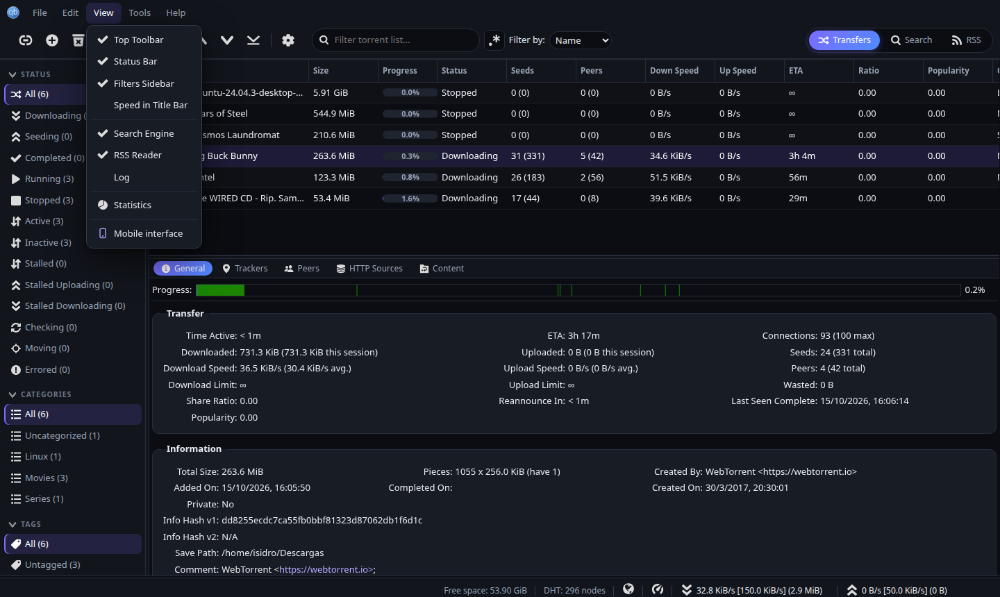
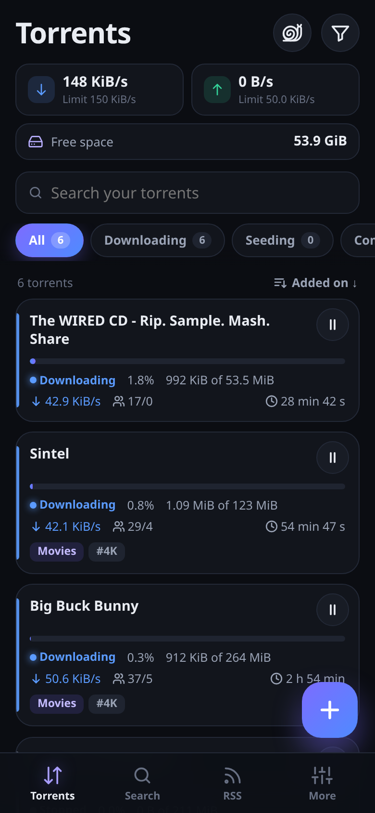
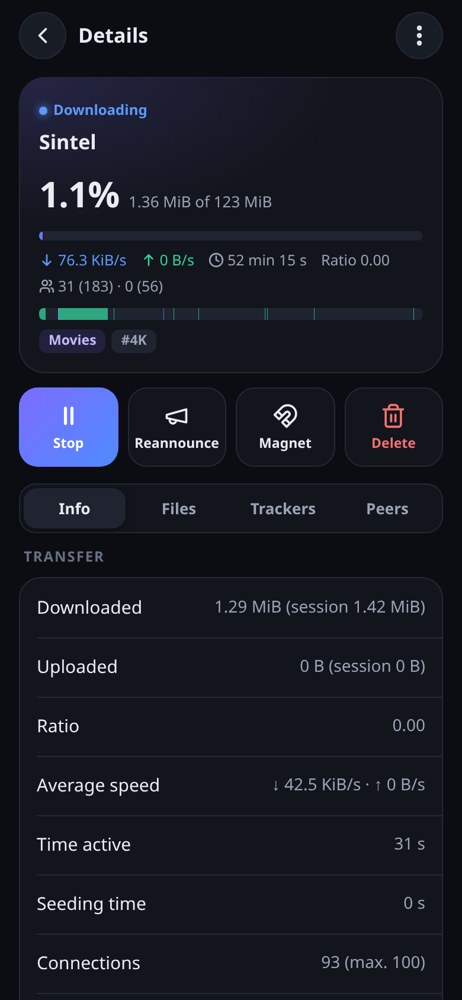
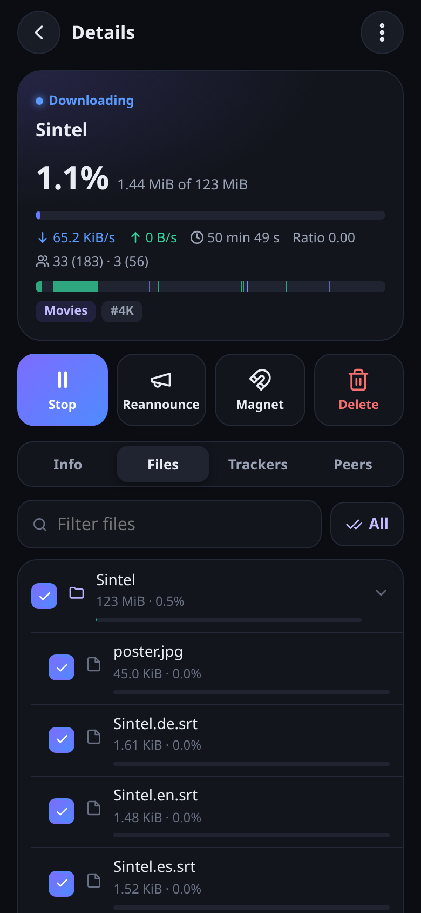
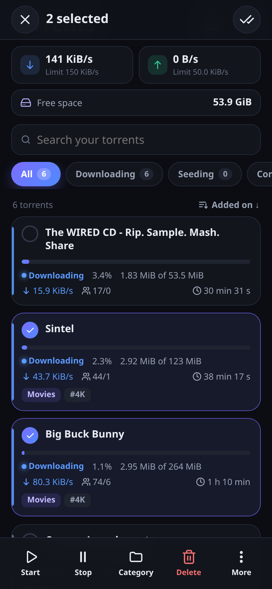
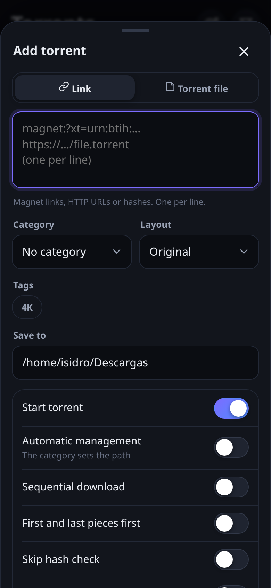
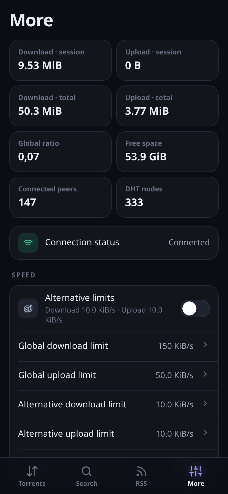
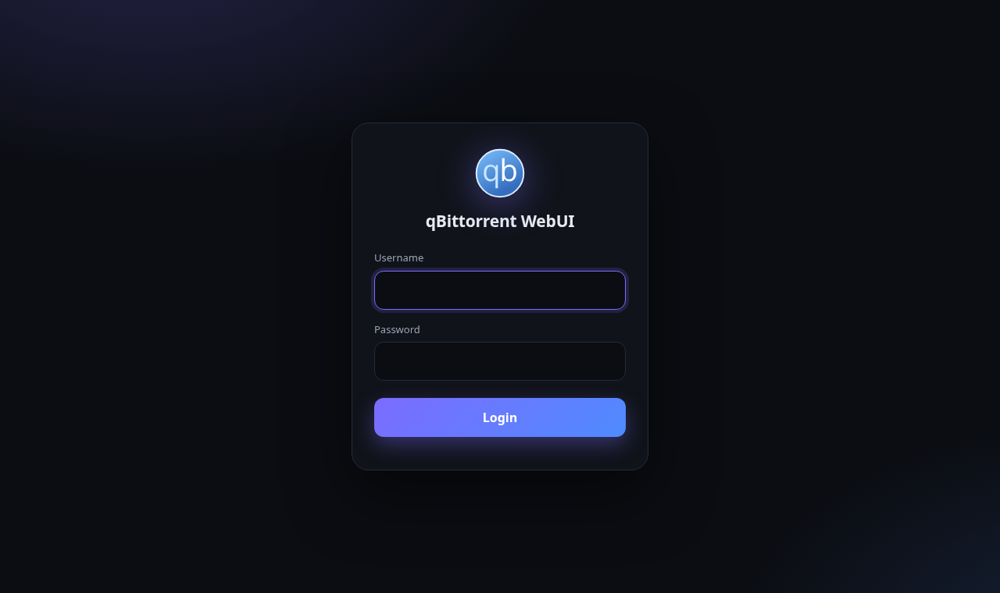

<h1 align="center">Penumbra</h1>

<p align="center">
  <b>A dark theme for the qBittorrent WebUI, optimized for both desktop and mobile.</b>
</p>

<p align="center">
  
  &nbsp;
  
</p>

Penumbra is an alternative WebUI for [qBittorrent](https://www.qbittorrent.org/) with two interfaces:

- 🖥️ **Desktop:** the full official WebUI, with preferences, RSS, search, log, statistics and context
  menus, plus a modern dark skin. Penumbra adds styles only and never changes the original JavaScript,
  so every feature keeps working.
- 📱 **Mobile:** phones automatically get a **dedicated touch-first app** with cards, gestures, bottom sheets
  and a bottom navigation bar. It can be **installed to the home screen** and works like a regular app (PWA).
- 🌐 **Language:** both interfaces follow the language set in qBittorrent. The desktop UI uses qBittorrent's
  official translations; the mobile UI is available in English and Spanish (other languages fall back to English).
  Translations are welcome in [`overlay/public/m/i18n.js`](overlay/public/m/i18n.js).
- 🪶 **No dependencies:** plain HTML, CSS and JavaScript, using the same API as the official WebUI.

## Screenshots

| List | Details | Files | Multi-select | Add | More |
|:-:|:-:|:-:|:-:|:-:|:-:|
|  |  |  |  |  |  |

<p align="center"></p>

## Installation

1. Download the `.zip` from the latest [**release**](../../releases). The file name says which qBittorrent
   version it was built for, for example `qbt5.1.4`.
2. Extract it on the machine that runs qBittorrent. You get a `penumbra/` folder.
3. In qBittorrent, open **Tools → Options → Web UI**, check **Use alternative WebUI** and select the
   `penumbra` folder.
4. Open `http://SERVER-IP:8080` (or whatever port you use) from your computer or your phone.

On headless `qbittorrent-nox`, you can enable it through the API:

```bash
curl -s http://127.0.0.1:8080/api/v2/app/setPreferences \
  --data-urlencode 'json={"alternative_webui_enabled":true,"alternative_webui_path":"/path/to/penumbra"}'
```

### Going back to the original WebUI

Uncheck the option in **Tools → Options → Web UI**, or run:

```bash
curl -s http://127.0.0.1:8080/api/v2/app/setPreferences \
  --data-urlencode 'json={"alternative_webui_enabled":false}'
```

If the WebUI doesn't load at all, quit qBittorrent and set `WebUI\AlternativeUIEnabled=false` in
`qBittorrent.conf` (on Linux it lives in `~/.config/qBittorrent/`).

## Using it on your phone

- Open your qBittorrent address and the mobile app loads automatically.
- To use it as an app, choose **Add to Home screen** from your browser menu.
- **Tap** a card to open its details (Info, Files, Trackers, Peers).
- **Long-press** to start multi-select, then start, stop, change category, delete and more.
- **▶ / ⏸** on each card starts or stops it instantly.
- **+** adds magnet links, URLs or `.torrent` files.
- The **snail** icon toggles the alternative speed limits. Tap the speeds to change the global limits.
- **More → Desktop version** opens the full WebUI from your phone. On desktop, **View → Mobile interface**
  takes you back to the mobile app.
- `mobile.html?add=magnet:?xt=...` opens the add form with the link already filled in.

## Other qBittorrent versions

Each `.zip` bundles the official WebUI of one specific qBittorrent version. If you run a different version,
build it yourself:

```bash
git clone https://github.com/IsidroPenh/penumbra.git
cd penumbra
./build.sh 5.1.4        # with no argument it detects the qbittorrent-nox version
```

The output goes to `dist/`. Point qBittorrent at that folder. To get the desktop UI in your language,
`build.sh` needs `lrelease` (the `qt6-l10n-tools` package on Debian/Ubuntu). If it can't find it, it tries
to install it with `pip` into a `.venv`.

### Project layout

```
build.sh                    downloads the official WebUI, compiles translations and applies the theme
overlay/                    the theme files (the only thing you need to edit)
  private/css/theme.css       desktop dark theme
  private/scripts/theme.js    automatic redirect to the mobile UI
  public/css/theme-login.css  login screen
  public/mobile.html          mobile UI
  public/m/                   app.js, app.css, i18n.js (translations), icons and manifest (installable)
```

## License

[GPL-3.0-or-later](LICENSE). Penumbra ships with the official qBittorrent WebUI, which is licensed under
GPL-2.0-or-later and MIT. This is not an official qBittorrent project.
