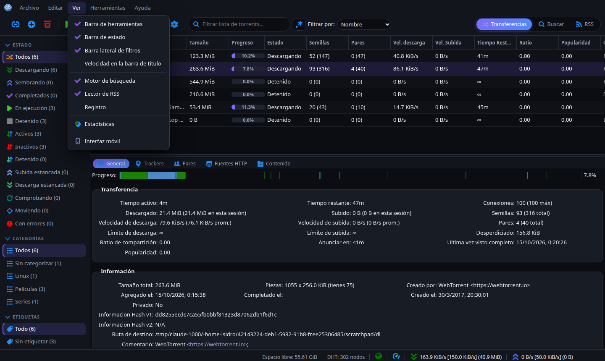
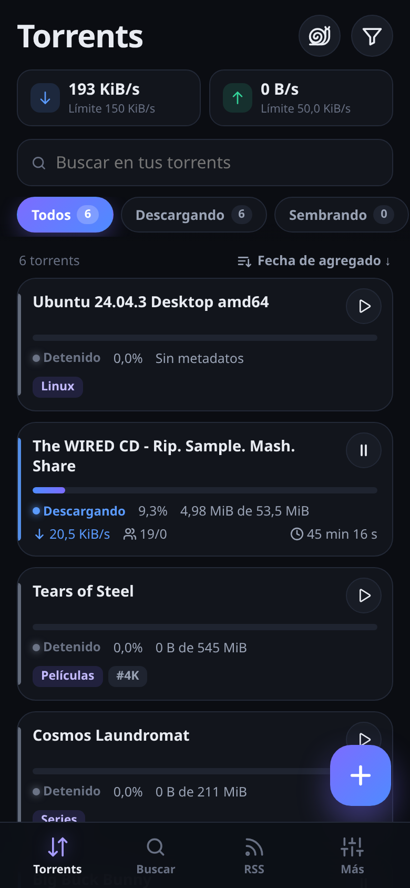
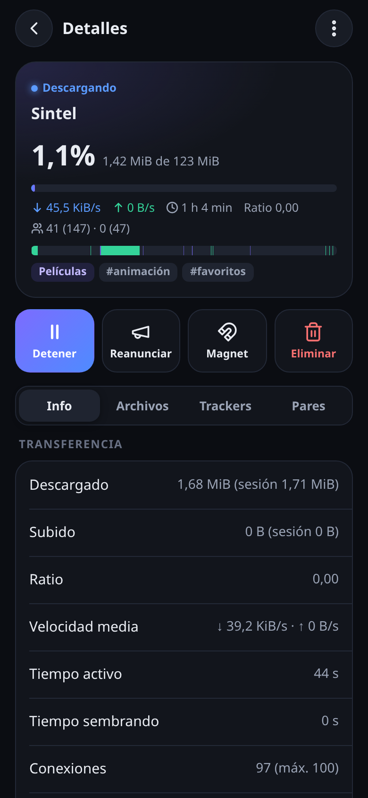
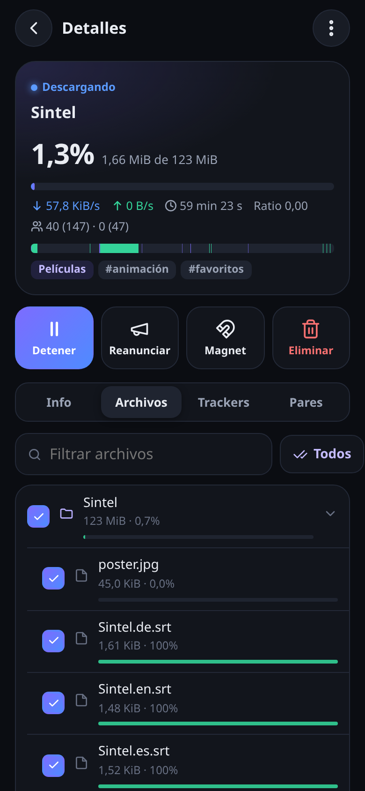
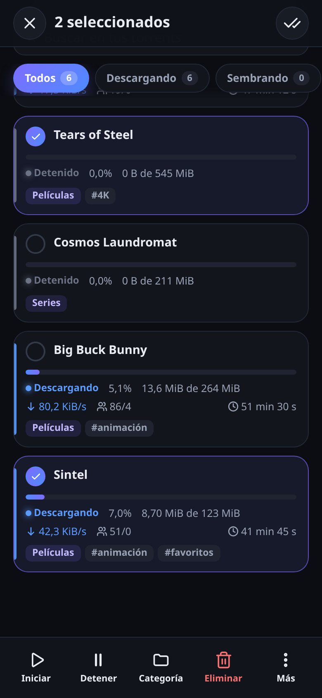
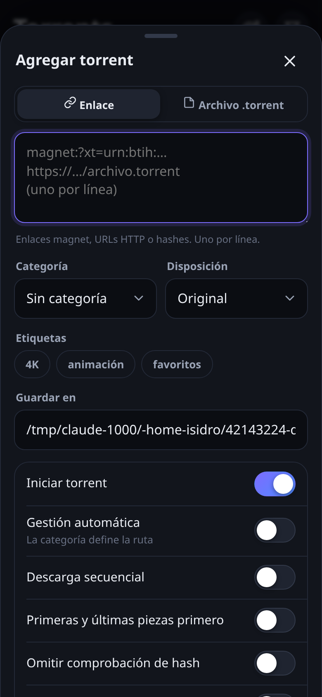
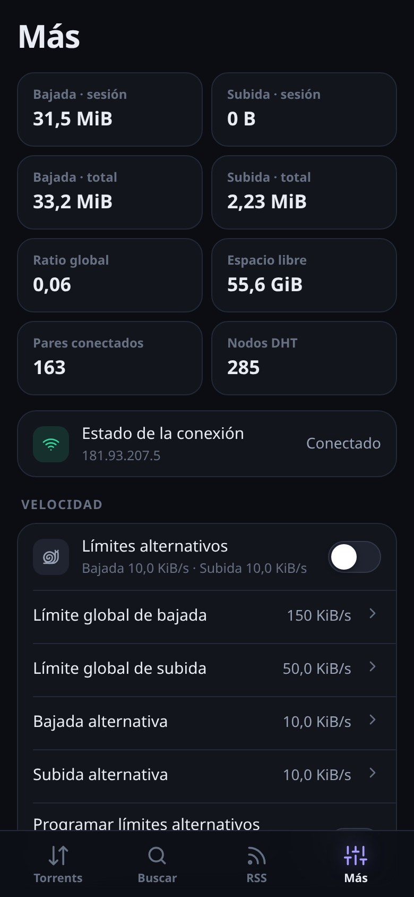
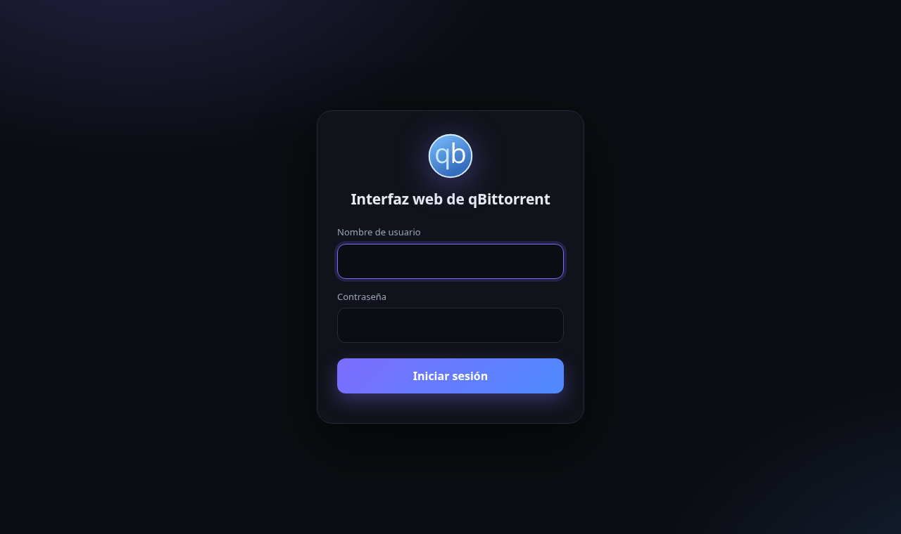

<h1 align="center">Penumbra</h1>

<p align="center">
  <b>Tema oscuro para el WebUI de qBittorrent, optimizado para escritorio y para el celular.</b><br>
  <sub><a href="#english">English below</a></sub>
</p>

<p align="center">
  
  &nbsp;
  
</p>

Penumbra es un WebUI alternativo para [qBittorrent](https://www.qbittorrent.org/) con dos interfaces:

- 🖥️ **Escritorio:** el WebUI oficial completo, con preferencias, RSS, buscador, registro, estadísticas y
  menús contextuales, más una capa visual oscura y moderna. Penumbra no toca el JavaScript original, solo
  agrega estilos, así que no se pierde ninguna función.
- 📱 **Celular:** si entras desde un teléfono, se abre sola una **app pensada para pantallas táctiles**:
  tarjetas, gestos, hojas deslizables y barra de navegación inferior. Se puede **instalar en la pantalla de
  inicio** y queda como una app más (PWA).
- 🌐 **Idioma:** el escritorio usa las traducciones oficiales de qBittorrent, así que sale en tu idioma.
  La interfaz móvil está en español.
- 🪶 **Sin dependencias:** solo HTML, CSS y JavaScript. Usa la misma API que el WebUI oficial.

## Capturas

| Lista | Detalle | Archivos | Selección múltiple | Agregar | Más |
|:-:|:-:|:-:|:-:|:-:|:-:|
|  |  |  |  |  |  |

<p align="center"></p>

## Instalación

1. Descarga el `.zip` de la última versión en [**Releases**](../../releases). El nombre del archivo indica
   para qué versión de qBittorrent está hecho, por ejemplo `qbt5.1.4`.
2. Descomprímelo en el equipo donde corre qBittorrent. Queda una carpeta `penumbra/`.
3. En qBittorrent ve a **Herramientas → Opciones → Interfaz web**, marca **Usar interfaz web alternativa**
   y elige la carpeta `penumbra`.
4. Abre `http://IP-DEL-SERVIDOR:8080` (o el puerto que uses) desde la PC o desde el celular.

Si usas `qbittorrent-nox` sin interfaz gráfica, puedes activarlo por la API:

```bash
curl -s http://127.0.0.1:8080/api/v2/app/setPreferences \
  --data-urlencode 'json={"alternative_webui_enabled":true,"alternative_webui_path":"/ruta/a/penumbra"}'
```

### Volver al WebUI original

Desmarca la opción en **Herramientas → Opciones → Interfaz web**, o:

```bash
curl -s http://127.0.0.1:8080/api/v2/app/setPreferences \
  --data-urlencode 'json={"alternative_webui_enabled":false}'
```

Si el WebUI no carga, cierra qBittorrent y pon `WebUI\AlternativeUIEnabled=false` en
`qBittorrent.conf` (en Linux está en `~/.config/qBittorrent/`).

## Uso en el celular

- Entra a la dirección de tu qBittorrent y se abre la interfaz móvil.
- Para usarla como app: en el menú del navegador elige **Agregar a pantalla de inicio**.
- **Toque** en una tarjeta: abre los detalles (Info, Archivos, Trackers, Pares).
- **Pulsación larga:** activa la selección múltiple para iniciar, detener, cambiar categoría, eliminar y más.
- **▶ / ⏸** en cada tarjeta: inicia o detiene al instante.
- **+**: agrega enlaces magnet, URLs o archivos `.torrent`.
- **Caracol:** activa los límites alternativos de velocidad. Si tocas las velocidades, cambias los límites globales.
- **Más → Versión escritorio** abre el WebUI completo desde el teléfono. Desde el escritorio,
  **Ver → Interfaz móvil** vuelve a la app móvil.
- `mobile.html?add=magnet:?xt=...` abre el formulario de agregar con el enlace ya puesto.

## Otra versión de qBittorrent

Cada `.zip` incluye el WebUI oficial de una versión concreta de qBittorrent. Si tienes otra versión, constrúyelo tú:

```bash
git clone https://github.com/IsidroPenh/penumbra.git
cd penumbra
./build.sh 5.1.4        # sin argumento detecta la versión de qbittorrent-nox
```

El resultado queda en `dist/`; esa es la carpeta que tienes que elegir en qBittorrent. Para que el escritorio
salga en tu idioma, `build.sh` necesita `lrelease` (paquete `qt6-l10n-tools` en Debian/Ubuntu). Si no lo
encuentra, intenta instalarlo con `pip` en un `.venv`.

### Cómo está hecho

```
build.sh                    descarga el WebUI oficial, compila traducciones y aplica el tema
overlay/                    los archivos del tema (lo único que hay que editar)
  private/css/theme.css       tema oscuro del escritorio
  private/scripts/theme.js    redirección automática a la interfaz móvil
  public/css/theme-login.css  pantalla de inicio de sesión
  public/mobile.html          interfaz móvil
  public/m/                   app.js, app.css, íconos y manifest (instalable)
```

## Licencia

[GPL-3.0-or-later](LICENSE). Penumbra se distribuye junto con el WebUI oficial de qBittorrent, que tiene
licencia GPL-2.0-or-later y MIT. No es un proyecto oficial de qBittorrent.

---

<a id="english"></a>

## English

**Penumbra** is a dark alternative WebUI for qBittorrent, **optimized for both desktop and mobile**.

- **Desktop:** the full official WebUI with a modern dark skin on top. No original JavaScript is changed, so every feature still works.
- **Mobile:** phones are automatically sent to a dedicated touch-first app (cards, long-press multi-select,
  bottom sheets) that can be **installed to the home screen** as a PWA. The mobile UI is in Spanish.

**Install:** download the `.zip` from [Releases](../../releases) that matches your qBittorrent version and extract it.
Then go to *Tools → Options → Web UI → Use alternative WebUI* and select the `penumbra` folder.
For other versions, run `./build.sh <version>` and point qBittorrent to `dist/`.

License: GPL-3.0-or-later.
